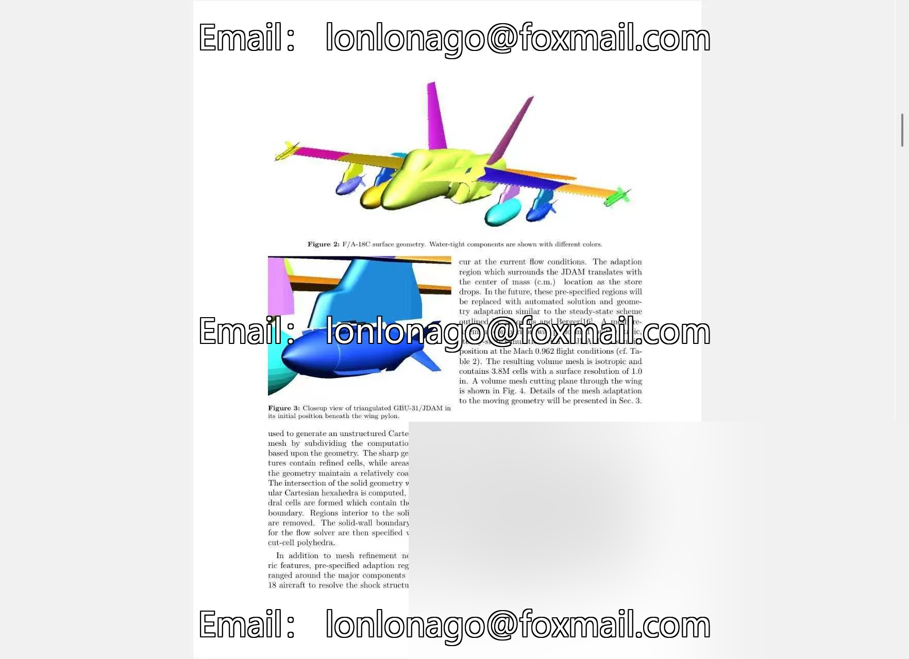
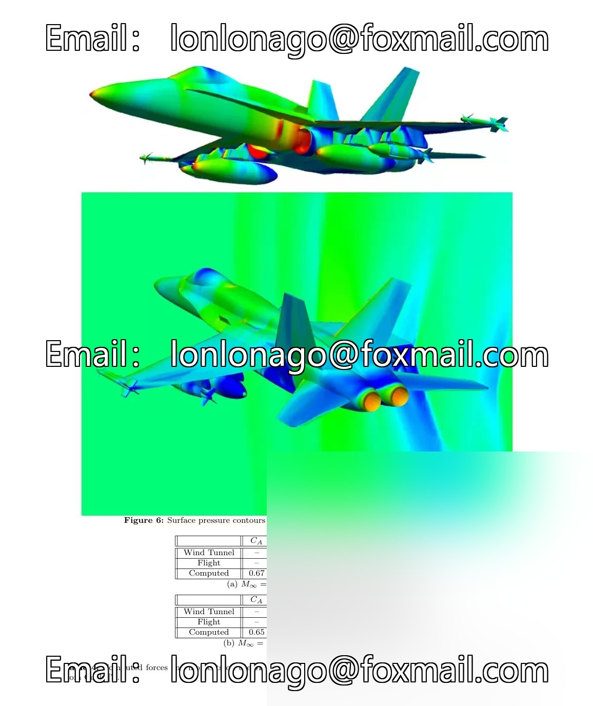
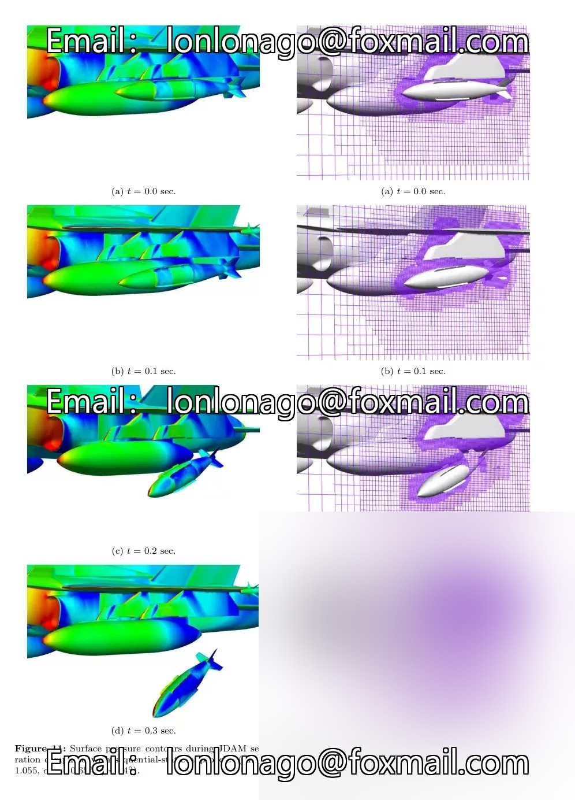

# F/A-18C fighter 6-DOF motion simulation, Cartesian grid

## Body

F/A-18C fighter 6-degree-of-freedom motion simulation, using Cartesian grid method, completed in collaboration with agencies such as NASA Ames Research Center and Courant Institute.
professionally content, suitable for learning reference of fluid mechanics, aviation engineering, and CFD.
Materials can be copied, upon sale.

The material provides 6-degree-of-freedom motion simulation for the F/A-18C fighter using Cartesian grids, with cooperation from NASA Ames Research Center and the Courant Institute; visual content includes surface geometry, watertight components, current flow conditions, regions and center of mass locations.

<!-- AI_ENRICHED -->

## Images

## Payment

Here is a pay link on Stripe ( https://buy.stripe.com/3cs8yP7sY87d0vu9AB ). Please contact me lonlonago@foxmail.com after funding $89, and I will send you a complete data files , thank you!

